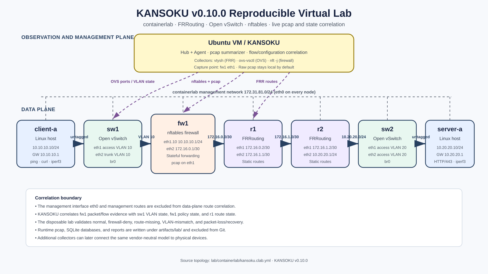

# KANSOKU v0.10.0

KANSOKU is a modular observation-driven framework for safe infrastructure operations. Version 0.10.0 adds cross-layer evidence graphs, alternative recommendation generation, explicit candidate ranking, named human review decisions, and a guarded executor that is restricted to the bundled containerlab environment. Production-device transports remain intentionally unavailable.

```text
Edge Agent
  ├─ ping / iperf3 / simulation
  ├─ tcpdump capture (96-byte snaplen by default)
  ├─ classic-pcap parser and 5-tuple flow aggregation
  ├─ local pcap retention and quota enforcement
  ├─ durable JSON spool
  └─ authenticated HTTP delivery of metadata
             ↓
KANSOKU Hub
  ├─ vendor-neutral device, interface, VLAN, route, and policy registry
  ├─ flow-to-configuration correlation and evidence
  ├─ cross-layer evidence graphs and evidence-coverage metrics
  ├─ ranked route, VLAN, firewall, and observation-only candidates
  ├─ model-level what-if evaluation and rollback templates
  ├─ named human review and containerlab-only apply/verify/rollback
  ├─ reproducible experiment definitions, trial records, and metrics export
  ├─ capture-session and flow-record registry
  ├─ idempotent remote ingest
  ├─ observations and raw command evidence
  ├─ automatic state estimation
  ├─ guarded control lifecycle
  └─ target, capture, flow, fleet, and agent dashboard
```

## Implemented modules

- **Agent**: simulation, macOS/Linux-aware ping, iperf3 JSON collection, tcpdump capture, offline pcap parsing, manual watch, and remote edge collection
- **Network state**: FRRouting route/interface import, Open vSwitch VLAN/link import, nftables policy import, vendor-neutral snapshots, and flow-to-configuration correlation
- **Evidence and recommendation**: persisted cross-layer evidence graphs, alternative FRR/OVS/nftables candidates, weighted candidate ranking, current/desired state diff, impact, pre/postconditions, rollback templates, model-level what-if validation, and JSON/Markdown/DOT export
- **Guarded virtual-lab remediation**: named review decisions, strict command-family allowlists, shell-free container execution, readback, fixed service verification, audit records, and rollback by default; production-device transports are not implemented
- **Experiment evaluation**: persisted experiment definitions and trials, deterministic seeds, expected/observed outcomes, timing and data-volume counters, environment manifests, lab-summary import, aggregate metrics, confusion counts, and CSV/JSON export
- **Packet/flow observation**: BPF-filtered capture, header-only default snaplen, IPv4/IPv6/TCP/UDP/ICMP parsing, VLAN extraction, 5-tuple aggregation, SHA-256 evidence identity, and local retention/quota enforcement
- **Edge delivery**: bearer-token authentication, durable FIFO spool, retry, heartbeat, and idempotent delivery of observations, runs, capture metadata, and bounded flow records
- **Remote registry**: agent creation, enable/disable, token rotation, capabilities, labels, and last-seen tracking
- **Ingest API**: authenticated heartbeat and batch-ingest endpoints with body-size limits and automatic state evaluation
- **Inventory / Service**: persistent multi-target scheduling, due-time calculation, lease protection, and scheduler-cycle audit records
- **Hub**: additive SQLite persistence compatible with earlier databases, including evidence graphs, recommendations, remediation executions, and experiment audit records
- **Profile / State**: target-relative, explainable operational-state estimation
- **Safety / Controller**: policy, approval, guarded execution, verification, and rollback
- **Dashboard**: target, network inventory, flow assessments, ranked recommendations, evidence graphs, virtual-lab remediation audits, capture sessions, top flows, fleet, scheduler, safe action lifecycle, remote agents, heartbeat, and latest ingest status
- **Replay**: CSV observation replay with automatic evaluation

## Requirements

- Python 3.10+
- `ping` for real reachability measurements
- `iperf3` for real throughput measurements
- `tcpdump` for live packet capture; offline pcap summarization requires only Python
- HTTPS reverse proxy when the ingest API is exposed beyond a trusted localhost or laboratory network

On macOS:

```bash
brew install python iperf3
```

## Installation

```bash
python3 -m venv .venv
source .venv/bin/activate
python -m pip install --upgrade pip
python -m pip install -e '.[dev]'
```

Initialize or migrate a Hub database:

```bash
kansoku --db ./kansoku.db init
```

Opening an earlier database is additive. v0.8 introduced the network-state tables:

```text
capture_sessions
flow_records
network_devices
network_snapshots
network_interfaces
network_vlans
network_links
network_routes
network_policy_rules
flow_assessments
```

v0.9 adds:

```text
configuration_recommendations
```

v0.9.1 adds:

```text
experiments
experiment_trials
```

v0.10.0 adds:

```text
evidence_graphs
remediation_executions
```

The v0.6 remote tables (`remote_agents`, `agent_heartbeats`, and `ingest_batches`) remain unchanged and their JSON payloads are backward compatible.

Earlier observations, profiles, policies, scheduler history, approvals, and controller transactions are retained.

# Reproducible live virtual lab

v0.10.0 includes an Ubuntu/containerlab environment that runs FRRouting routers, Open vSwitch L2 devices, an nftables firewall, and client/server hosts. It validates real packet capture and live state collection rather than fixture JSON alone.

[](docs/virtual-lab.md)

The diagram separates the service data plane from the containerlab management plane and marks the live KANSOKU collection points. See [`docs/virtual-lab.md`](docs/virtual-lab.md) for addressing, observation boundaries, and scenario details, and [`docs/validation-v0.10.0.md`](docs/validation-v0.10.0.md) for the Ubuntu integration record.

The lab explicitly excludes FRRouting interface `eth0` from route correlation because containerlab uses it for out-of-band management.

Reference VM sizing is 6 vCPU, 12 GiB RAM, and 80 GiB disk. macOS users run the lab inside an Ubuntu Server 24.04 VM.

```bash
./lab/vm/bootstrap-ubuntu.sh
make lab-up
make lab-test
make lab-down
```

The suite covers five network scenarios, three model-level recommendation checks, and three approved containerlab-only remediation cycles with post-change verification and rollback verification. Raw scenario reports are written under `artifacts/lab/reports/`; reproducibility manifests, imported trials, CSV exports, and aggregate metrics are written under `artifacts/lab/evaluation/`. See [`lab/README.md`](lab/README.md) for the topology and operational details.

Live read-only collection from a lab container uses:

```bash
python -m kansoku --db ./lab.db network collect frr-routes \
  --device-id r1 \
  --container clab-kansoku-v100-r1
```

The lab scripts use `python -m kansoku` through `.lab-venv` to avoid an older globally installed console launcher shadowing the current source tree.


# Network state model and open-source reference adapters

Import the reproducible FRRouting, Open vSwitch, and nftables fixtures:

```bash
kansoku --db ./kansoku.db network import frr --device-id r1 --file scenarios/virtual-lab/frr-r1.json
kansoku --db ./kansoku.db network import ovs --device-id sw1 --file scenarios/virtual-lab/ovs-sw1.json
kansoku --db ./kansoku.db network import nft --device-id fw1 --file scenarios/virtual-lab/nft-fw1.json
```

Inspect the normalized state:

```bash
kansoku --db ./kansoku.db network topology
kansoku --db ./kansoku.db network routes --device-id r1
kansoku --db ./kansoku.db network vlans --device-id sw1
kansoku --db ./kansoku.db network policies --device-id fw1
```

Correlate a capture with the imported route, firewall, and VLAN state:

```bash
kansoku --db ./kansoku.db network correlate \
  --capture-id capture-xxxxxxxxxxxx \
  --ingress-device fw1 \
  --route-device r1 \
  --policy-device fw1 \
  --vlan-device sw1
```

The correlation engine performs longest-prefix route lookup, ordered basic firewall-rule matching, and VLAN existence checks. It produces `ALLOW`, `DENY`, `UNROUTABLE`, or `UNKNOWN` evidence records. It is an explainable research reference, not a complete replacement for vendor control-plane semantics or Batfish-class formal verification.


# Evidence, candidate ranking, and guarded lab remediation

Build and persist a cross-layer evidence graph. DOT output can be rendered with Graphviz:

```bash
kansoku --db ./kansoku.db recommend evidence \
  --assessment-id assessment-xxxxxxxxxxxx \
  --route-device r1 --policy-device fw1 --vlan-device sw1 \
  --format dot --output ./artifacts/config/evidence.dot
```

Generate and rank a compact alternative set. The score combines model repair probability, evidence coverage, reversibility, blast-radius safety, security safety, and change simplicity:

```bash
kansoku --db ./kansoku.db recommend candidates \
  --assessment-id assessment-xxxxxxxxxxxx \
  --route-device r1 --policy-device fw1 --vlan-device sw1 \
  --destination-prefix 10.20.20.0/24 \
  --next-hop 172.16.1.2 --out-interface eth2
```

Generate a single reviewable change plan from one stored abnormal assessment:

```bash
kansoku --db ./kansoku.db recommend generate \
  --assessment-id assessment-xxxxxxxxxxxx \
  --route-device r1 \
  --policy-device fw1 \
  --vlan-device sw1
```

For a missing route, supply the intended topology information explicitly:

```bash
kansoku --db ./kansoku.db recommend generate \
  --assessment-id assessment-xxxxxxxxxxxx \
  --route-device r1 \
  --policy-device fw1 \
  --destination-prefix 10.20.20.0/24 \
  --next-hop 172.16.1.2 \
  --out-interface eth2
```

For VLAN drift, identify the intended access/trunk ports:

```bash
kansoku --db ./kansoku.db recommend generate \
  --assessment-id assessment-xxxxxxxxxxxx \
  --route-device r1 \
  --policy-device fw1 \
  --vlan-device sw1 \
  --access-interface eth1 \
  --trunk-interface eth2
```

Inspect and validate the stored review packet:

```bash
kansoku --db ./kansoku.db recommend list --target virtual-lab-path
kansoku --db ./kansoku.db recommend show --recommendation-id recommendation-xxxxxxxxxxxx
kansoku --db ./kansoku.db recommend validate --recommendation-id recommendation-xxxxxxxxxxxx
```

Export a Markdown packet for review:

```bash
kansoku --db ./kansoku.db recommend export \
  --recommendation-id recommendation-xxxxxxxxxxxx \
  --format markdown \
  --output ./artifacts/config/recommendation.md
```

The generated object includes:

- the triggering flow assessment and packet/flow evidence;
- current and desired vendor-neutral state;
- narrow FRR, OVS, or nftables command templates;
- rollback command templates;
- impact and risk;
- preconditions and postconditions;
- a model-level before/after verdict.

Record a named review decision before any lab execution:

```bash
kansoku --db ./kansoku.db recommend review \
  --recommendation-id recommendation-xxxxxxxxxxxx \
  --status APPROVED --reviewed-by operator@example \
  --note "approved for the isolated virtual lab only"
```

Apply, verify, and roll back inside the named containerlab topology:

```bash
kansoku --db ./kansoku.db recommend apply-lab \
  --recommendation-id recommendation-xxxxxxxxxxxx \
  --environment virtual-lab \
  --approved-by operator@example \
  --lab-name kansoku-v100
```

The executor accepts only `nft`, `vtysh`, or `ovs-vsctl` for the recommendation's expected platform, never invokes a shell, records readback and service verification, and rolls back by default. `--keep-change` is explicit and remains limited to the virtual lab.

**Safety boundary:** v0.10.0 has no SSH, NETCONF, RESTCONF, gNMI, or vendor API transport. It cannot apply a recommendation to a production device. Human policy confirmation and an out-of-band management path remain mandatory for future production-oriented work.

# Reproducible experiments and evaluation exports

Create an experiment definition with explicit scenarios, repetitions, seeds, baselines, and metrics:

```bash
EXPERIMENT_JSON="$(kansoku --db ./evaluation.db experiment create \
  --name "cross-layer diagnosis evaluation" \
  --scenario normal \
  --scenario firewall-deny \
  --scenario route-missing \
  --repetitions 20 \
  --base-seed 20260718 \
  --baseline flow-only \
  --baseline configuration-only)"
```

Capture a machine-readable environment manifest:

```bash
kansoku experiment manifest \
  --output ./artifacts/evaluation/environment.json \
  --label site=ubuntu-lab \
  --label topology=kansoku-v100
```

Record a trial with ground truth, observed output, timings, counters, and artifacts:

```bash
kansoku --db ./evaluation.db experiment record \
  --experiment-id experiment-xxxxxxxxxxxx \
  --scenario-id firewall-deny \
  --repetition 1 \
  --seed 20260719 \
  --status PASS \
  --expected-verdict DENY \
  --observed-verdict DENY \
  --expected-category FIREWALL_POLICY \
  --observed-category FIREWALL_POLICY \
  --timing diagnosis=18.4 \
  --timing recommendation=7.1 \
  --counter observation_bytes=16384 \
  --artifact report=artifacts/lab/reports/firewall-deny.json \
  --environment-manifest artifacts/evaluation/environment.json
```

Import the existing containerlab summary as eight evaluation trials—five network scenarios and three recommendation what-if checks—and export publication-oriented data:

```bash
kansoku --db ./evaluation.db experiment import-lab \
  --experiment-id experiment-xxxxxxxxxxxx \
  --summary ./artifacts/lab/reports/summary.json \
  --environment-manifest ./artifacts/lab/evaluation/environment.json

kansoku --db ./evaluation.db experiment summarize \
  --experiment-id experiment-xxxxxxxxxxxx

kansoku --db ./evaluation.db experiment export \
  --experiment-id experiment-xxxxxxxxxxxx \
  --output-dir ./artifacts/evaluation/export
```

The export contains `experiment.json`, `trials.json`, `trials.csv`, and `summary.json`. Aggregate output includes pass rate, verdict and recommendation accuracy, recovery accuracy, per-scenario results, timing distributions, counter distributions, and verdict-confusion counts. The initial 18-scenario catalog is stored at [`scenarios/evaluation/catalog.json`](scenarios/evaluation/catalog.json); five scenarios are implemented and the remaining entries define the next evaluation backlog. See [`docs/experiments.md`](docs/experiments.md).

# Packet and flow observation

## Rootless offline pcap summarization

Generate the deterministic sample file included for tests:

```bash
python scripts/generate_sample_pcap.py ./sample.pcap
```

Parse it and persist capture/flow metadata:

```bash
kansoku --db ./kansoku.db capture summarize \
  --pcap ./sample.pcap \
  --target sample-path \
  --source offline-test
```

Inspect sessions and aggregated flows:

```bash
kansoku --db ./kansoku.db capture list --target sample-path
kansoku --db ./kansoku.db capture flows --target sample-path --limit 20
```

Offline imports are idempotent by `target`, `source`, and pcap SHA-256. Repeating the same command returns `import_status: DUPLICATE` and does not add another capture, flow set, or observation set. Use the explicit override only when a separate analysis session is intentional:

```bash
kansoku --db ./kansoku.db capture summarize \
  --pcap ./sample.pcap \
  --target sample-path \
  --source offline-test \
  --force-reimport
```

The generated sample contains a valid TCP three-way handshake and a valid mDNS PTR query with correct IPv4, TCP, and UDP checksums.

v0.7 parses classic pcap files directly with the Python standard library. Ethernet, VLAN, Linux cooked capture, raw IP, and common loopback link types are supported. pcapng is intentionally rejected in v0.7; use tcpdump classic pcap output or convert the file before import.

## Live capture

List interfaces:

```bash
kansoku capture interfaces
```

Capture ten seconds of TCP/443 metadata:

```bash
sudo -E .venv/bin/kansoku --db ./kansoku.db capture run \
  --target web-path \
  --interface en0 \
  --duration 10 \
  --filter 'tcp port 443'
```

The default snaplen is 96 bytes and is recorded as `headers-only`. Complete packet capture requires the explicit `--full-packet` flag:

```bash
sudo -E .venv/bin/kansoku --db ./kansoku.db capture run \
  --target controlled-test \
  --interface en0 \
  --duration 5 \
  --filter 'host 192.0.2.10' \
  --full-packet
```

Full-packet mode can retain application payload and must be limited to an authorized test environment. Raw pcap is stored locally under `~/.kansoku/pcap` by default and is never uploaded by the v0.7 ingest API.

## Retention and quota

Defaults are seven days and 512 MiB:

```bash
kansoku --db ./kansoku.db capture prune \
  --retention-days 7 \
  --quota-mb 512 \
  --dry-run
```

Remove `--dry-run` to delete local pcap files. Capture metadata and flow summaries remain in SQLite with status `PRUNED`.

## Remote pcap metadata delivery

Summarize an existing file at an edge node and send metadata only:

```bash
kansoku edge pcap \
  --hub-url http://127.0.0.1:8090 \
  --agent-id lab-edge-1 \
  --token-file ./lab-edge-1.agent-token \
  --spool-dir ~/.kansoku/spool \
  --pcap ./sample.pcap \
  --target remote-path \
  --send-flow-limit 500
```

Live edge capture uses the same privacy boundary:

```bash
sudo -E .venv/bin/kansoku edge capture \
  --hub-url http://127.0.0.1:8090 \
  --agent-id lab-edge-1 \
  --token-file ./lab-edge-1.agent-token \
  --spool-dir ~/.kansoku/spool \
  --target remote-path \
  --interface en0 \
  --duration 10 \
  --filter 'ip and not port 22'
```

The pcap path stored at the Hub is provenance for the edge artifact (`storage_scope=edge`); it is not a downloadable Hub-side file.

# Local persistent observation

The v0.5 workflow remains available.

```bash
kansoku --db ./kansoku.db profile set \
  --target 172.16.10.210 \
  --name "100 Mbps laboratory path" \
  --expected-bandwidth 100 \
  --normal-interval 30 \
  --warning-interval 5

kansoku --db ./kansoku.db policy set \
  --target 172.16.10.210 \
  --name "Laboratory safe policy" \
  --minimum-interval 2 \
  --no-allow-system-changes

kansoku --db ./kansoku.db target set \
  --target 172.16.10.210 \
  --name "Laboratory server" \
  --ping-enabled \
  --ping-count 5 \
  --iperf3-enabled \
  --iperf3-port 5201 \
  --iperf3-duration 10 \
  --iperf3-every 5

kansoku --db ./kansoku.db service run --poll-interval 1
```

# Distributed observation

## 1. Register a remote agent on the Hub

Create an agent and write its one-time token to a protected file:

```bash
kansoku --db ./kansoku.db remote-agent create \
  --name "Laboratory edge agent" \
  --agent-id lab-edge-1 \
  --capabilities ping,iperf3,pcap,flow \
  --label site=building-a \
  --label role=network-observer \
  --token-file ./lab-edge-1.agent-token
```

The token is shown only once, or written to the specified file. The Hub stores only a PBKDF2-HMAC-SHA256-derived token hash and a short fingerprint.

Inspect registrations:

```bash
kansoku --db ./kansoku.db remote-agent list
kansoku --db ./kansoku.db remote-agent show --agent-id lab-edge-1
```

Disable or re-enable an agent:

```bash
kansoku --db ./kansoku.db remote-agent disable --agent-id lab-edge-1
kansoku --db ./kansoku.db remote-agent enable  --agent-id lab-edge-1
```

Rotate a compromised or expired token:

```bash
kansoku --db ./kansoku.db remote-agent rotate-token \
  --agent-id lab-edge-1 \
  --token-file ./lab-edge-1.agent-token
```

Token rotation invalidates the previous token immediately.

## 2. Start the ingest API on the Hub

Local laboratory test:

```bash
kansoku --db ./kansoku.db ingest serve \
  --host 127.0.0.1 \
  --port 8090
```

Health endpoint:

```bash
curl http://127.0.0.1:8090/health
```

For access from another machine, bind to an appropriate interface only after placing the service behind HTTPS:

```bash
kansoku --db ./kansoku.db ingest serve \
  --host 0.0.0.0 \
  --port 8090
```

The built-in server authenticates agents but does not terminate TLS. Use a reverse proxy such as nginx, Caddy, or an SSH tunnel for untrusted networks.

## 3. Collect and deliver from an edge node

The token can be loaded from a file:

```bash
kansoku edge ping \
  --hub-url http://127.0.0.1:8090 \
  --agent-id lab-edge-1 \
  --token-file ./lab-edge-1.agent-token \
  --spool-dir ~/.kansoku/spool \
  --target 172.16.10.210 \
  --count 5
```

Or from an environment variable:

```bash
export KANSOKU_AGENT_TOKEN='the-one-time-token'

kansoku edge iperf3 \
  --hub-url http://127.0.0.1:8090 \
  --agent-id lab-edge-1 \
  --target 172.16.10.210 \
  --duration 10
```

Simulation is useful before enabling real probes:

```bash
kansoku edge simulate \
  --hub-url http://127.0.0.1:8090 \
  --agent-id lab-edge-1 \
  --token-file ./lab-edge-1.agent-token \
  --target remote-demo \
  --profile warning
```

Each command first writes an atomic JSON batch to the local spool. It then attempts FIFO delivery. A communication failure does not discard the observations.

## 4. Offline spool and retry

Collect without contacting the Hub:

```bash
kansoku edge ping \
  --hub-url http://127.0.0.1:8090 \
  --agent-id lab-edge-1 \
  --token-file ./lab-edge-1.agent-token \
  --spool-dir ~/.kansoku/spool \
  --target 172.16.10.210 \
  --spool-only
```

Inspect the queue:

```bash
kansoku edge status --spool-dir ~/.kansoku/spool
```

Flush queued batches:

```bash
kansoku edge flush \
  --hub-url http://127.0.0.1:8090 \
  --agent-id lab-edge-1 \
  --token-file ./lab-edge-1.agent-token \
  --spool-dir ~/.kansoku/spool
```

Delivery is idempotent by `batch_id`. Resending an already accepted batch returns `DUPLICATE` and does not duplicate observations or collection runs.

## 5. Heartbeat

```bash
kansoku edge heartbeat \
  --hub-url http://127.0.0.1:8090 \
  --agent-id lab-edge-1 \
  --token-file ./lab-edge-1.agent-token \
  --spool-dir ~/.kansoku/spool
```

The heartbeat records:

- agent identity;
- hostname and KANSOKU version;
- online status;
- current spool depth;
- platform metadata;
- Hub-side last-seen time.

# Ingest behavior

The Hub performs the following sequence for an authenticated batch:

```text
Authenticate agent
  ↓
Validate body size and JSON structure
  ↓
Check batch_id for replay/idempotency
  ↓
Persist raw CollectionRun records
  ↓
Persist normalized Observations
  ↓
Persist CaptureSession and bounded FlowRecord metadata
  ↓
Attach remote_agent_id and batch_id labels
  ↓
Persist IngestReceipt
  ↓
Update agent last_seen_at
  ↓
Automatically evaluate affected targets only when state-engine metrics are present
```

The default request-body limit is 4 MiB and can be changed with `--max-body-bytes`.

Automatic state evaluation can be disabled for specialized import workflows:

```bash
kansoku --db ./kansoku.db ingest serve --no-auto-evaluate
```

# Dashboard

```bash
kansoku --db ./kansoku.db web \
  --host 127.0.0.1 \
  --port 8080
```

Open `http://127.0.0.1:8080`.

The v0.10 dashboard includes:

- operational state and evidence;
- target profile and observation plan;
- managed-target and scheduler status;
- fleet table;
- Safety Policy and Controller lifecycle;
- registered remote agents;
- agent enabled/disabled state;
- capabilities and last-seen time;
- latest heartbeat and spool depth;
- latest ingest receipt;
- packet-capture sessions and privacy/storage scope;
- top aggregated flows with endpoints, ports, VLAN, packets, and bytes;
- ranked configuration recommendations and model-level what-if outcomes;
- cross-layer evidence-graph coverage;
- guarded virtual-lab apply, verification, and rollback audit records;
- observations and raw collection runs.

The dashboard is read-only and binds to localhost by default.

# Security and privacy boundary

KANSOKU v0.10.0 is a research prototype. Generated commands can be executed only through the containerlab-only executor after a named approval; production transports are absent.

- Live capture defaults to a 96-byte snaplen and `headers-only` mode.
- Raw pcap is never included in an `IngestBatch`; only capture provenance, summary observations, and a bounded number of flow records are sent.
- `--full-packet` is explicit because it may retain application payload.
- BPF filters, retention duration, and storage quota should be configured before production-like capture.
- pcap and pcapng files are excluded from Git by default.
- Remote tokens are generated with `secrets.token_urlsafe(32)`.
- The Hub stores PBKDF2-HMAC-SHA256 token hashes, not plaintext tokens.
- Token comparisons use constant-time comparison.
- Tokens are accepted only through a file or environment variable on edge CLI commands; there is no `--token` argument that would expose the secret in shell history.
- Spool files contain observations and command evidence, but never the token.
- Spool directories and files are written with owner-only permissions where supported.
- Disabled agents cannot send heartbeat or ingest data.
- Batch replay is idempotent.
- The ingest server does not provide TLS; use HTTPS or an SSH tunnel outside a trusted lab.
- Distributed observation does not grant additional system-control privileges. Existing Guard, Approval, Act, Verify, and rollback requirements remain unchanged.

# Testing

```bash
python -m compileall -q kansoku
python -m pytest -q
```

Expected result:

```text
106 passed
```

macOS integration test:

```bash
./scripts/macos_smoke_test.sh
```

The smoke test covers:

- clean editable installation;
- all automated tests;
- ping and iperf3;
- persistent target service;
- Safety Policy, Approval, Controller, and Verification;
- remote-agent registration and token-file creation;
- ingest server startup;
- edge simulation and pcap metadata through the durable spool;
- heartbeat;
- automatic remote state evaluation;
- offline pcap parsing, capture-session persistence, flow aggregation, and Dashboard capture data;
- dashboard fleet and remote-agent APIs;
- SQLite migration and audit records.

Release checks:

```bash
./scripts/pre_release_check.sh
```

Runtime databases, raw command artifacts, pcap/pcapng files, `.env` files, edge spool directories, and agent-token files are excluded from Git.
