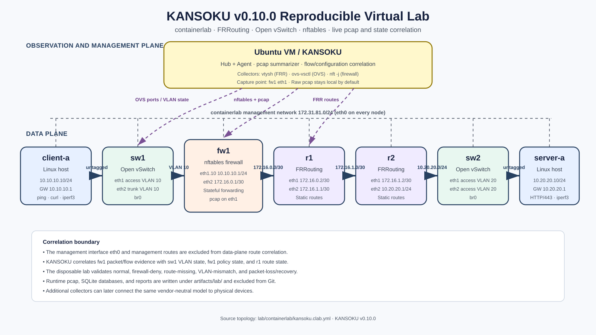
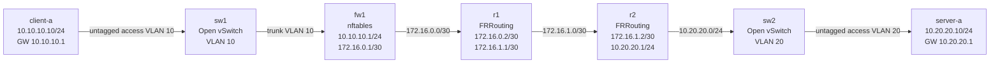

# KANSOKU reproducible virtual network laboratory

The KANSOKU v0.10.0 laboratory is a disposable, reproducible network used to validate the complete observation-to-assessment pipeline against running open-source components. It is designed for Ubuntu Server 24.04 and containerlab, and can be hosted inside a virtual machine on macOS, Windows, or Linux.

[](images/virtual-lab-topology.svg)

## Purpose

The lab verifies that KANSOKU can:

1. generate real ICMP, HTTP, and iperf3 traffic;
2. capture packets at the firewall observation point;
3. summarize pcap into privacy-aware flow metadata;
4. collect live FRRouting, Open vSwitch, and nftables state;
5. normalize device-specific state into the vendor-neutral network model;
6. correlate observed flows with routes, VLANs, and firewall policy; and
7. distinguish normal forwarding from injected configuration and network faults;
8. generate and rank evidence-grounded remediation candidates; and
9. apply, verify, and roll back approved changes inside the disposable lab.

## Data-plane topology



## Addressing and node roles

| Node | Implementation | Data-plane interfaces | Role |
|---|---|---|---|
| `client-a` | Linux | `eth1: 10.10.10.10/24` | Generates ping, HTTP, and iperf3 traffic |
| `sw1` | Open vSwitch | `eth1` access VLAN 10; `eth2` trunk VLAN 10 | Client-side L2 forwarding and VLAN-state source |
| `fw1` | Linux + nftables | `eth1.10: 10.10.10.1/24`; `eth2: 172.16.0.1/30` | Stateful firewall, VLAN gateway, and pcap observation point |
| `r1` | FRRouting | `eth1: 172.16.0.2/30`; `eth2: 172.16.1.1/30` | Route-state source used by flow correlation |
| `r2` | FRRouting | `eth1: 172.16.1.2/30`; `eth2: 10.20.20.1/24` | Server-side router |
| `sw2` | Open vSwitch | `eth1` and `eth2` access VLAN 20 | Server-side L2 forwarding |
| `server-a` | Linux | `eth1: 10.20.20.10/24` | HTTP service on TCP/443 and iperf3 service on TCP/5201 |

Every container also has a containerlab management interface, `eth0`, on `172.31.81.0/24`.

## Observation and correlation points

KANSOKU runs on the Ubuntu VM, outside the seven data-plane containers. The integration scenarios collect the following evidence:

| Evidence | Source | KANSOKU use |
|---|---|---|
| Packet capture | `fw1:eth1` | Header/flow evidence for the client-to-server communication |
| Port and VLAN state | `sw1` via `ovs-vsctl` | Confirms whether observed VLAN tags are represented in current switch state |
| Firewall rules | `fw1` via `nft -j list ruleset` | Determines whether a flow matches an allow or deny rule |
| Route state | `r1` via `vtysh -c "show ip route json"` | Performs longest-prefix lookup for the observed destination |

The correlation path is:

```text
live traffic
  → pcap at fw1
  → 5-tuple flow metadata
  → OVS VLAN state + nftables policy + FRR route state
  → ALLOW / DENY / UNROUTABLE / UNKNOWN evidence
```

## Management-plane exclusion

The containerlab management network is deliberately outside the data-plane model. FRRouting containers may have an `eth0` management default route that is valid for container administration but invalid as evidence for the tested service path.

The lab therefore collects FRR state with:

```bash
python -m kansoku --db ./lab.db network collect frr-routes \
  --device-id r1 \
  --container clab-kansoku-v100-r1 \
  --exclude-interface eth0
```

The exclusion is explicit and recorded in `NetworkSnapshot.metadata`; it is not silently discarded.

## Required virtual machine

Recommended minimum for the complete seven-node lab:

| Resource | Recommended value |
|---|---:|
| Guest OS | Ubuntu Server 24.04 LTS |
| vCPU | 6 |
| RAM | 12 GiB |
| Disk | 80 GiB |
| Network | NAT/shared network with Internet access during installation |

Apple Silicon users should use an ARM64 Ubuntu guest. Intel and AMD hosts should use AMD64. The standard lab intentionally uses open-source components with multi-architecture images.

## Installation and execution

```bash
./lab/vm/bootstrap-ubuntu.sh
```

When Docker group membership changes, log out and log back in. Then run:

```bash
make lab-up
make lab-status
make lab-test
make lab-down
```

A successful integration run ends with:

```text
[PASS] normal → ALLOW
[PASS] firewall-deny → DENY
[PASS] route-missing → UNROUTABLE
[PASS] vlan-mismatch → UNKNOWN / UNKNOWN_VLAN
[PASS] packet-loss injection and recovery
[PASS] 5/5 virtual-lab scenarios, 3/3 recommendation checks, and 3/3 guarded remediations
[PASS] reproducible experiment import/export → 11 trials
```

Runtime results are written under:

```text
artifacts/lab/
├── db/
├── pcap/
└── reports/
```

These files can contain local network evidence and are excluded from Git.

## Fault scenarios

| Scenario | Injected condition | Expected connectivity | Expected KANSOKU result |
|---|---|---|---|
| `normal` | Baseline route, VLAN, and firewall state | ping, HTTP, and iperf3 succeed | `ALLOW` |
| `firewall-deny` | Insert TCP/443 drop rule | HTTP fails | `DENY` |
| `route-missing` | Remove the r1 route to `10.20.20.0/24` | HTTP fails | `UNROUTABLE` |
| `vlan-mismatch` | Change sw1 VLAN configuration from 10 to 30 | HTTP fails | `UNKNOWN` with `UNKNOWN_VLAN` |
| `packet-loss` | Apply `tc netem loss 100%` | ping fails and later recovers | fault injection and recovery pass |

## Safety boundary

The integration suite changes only disposable containers and their virtual interfaces. The remediation executor has no production transport, requires a named approval, rejects unresolved command placeholders, allowlists `nft`, `vtysh`, or `ovs-vsctl` according to the recommendation category, and never invokes a shell. It does not modify the Ubuntu VM's production routing table or firewall policy. The lab should still be run on a dedicated test VM because Docker/containerlab access provides substantial host privileges.

## Source files

- Topology: [`lab/containerlab/kansoku.clab.yml`](../lab/containerlab/kansoku.clab.yml)
- Lab operations: [`lab/README.md`](../lab/README.md)
- Validation record: [`docs/validation-v0.10.0.md`](validation-v0.10.0.md)
- SVG topology: [`docs/images/virtual-lab-topology.svg`](images/virtual-lab-topology.svg)
